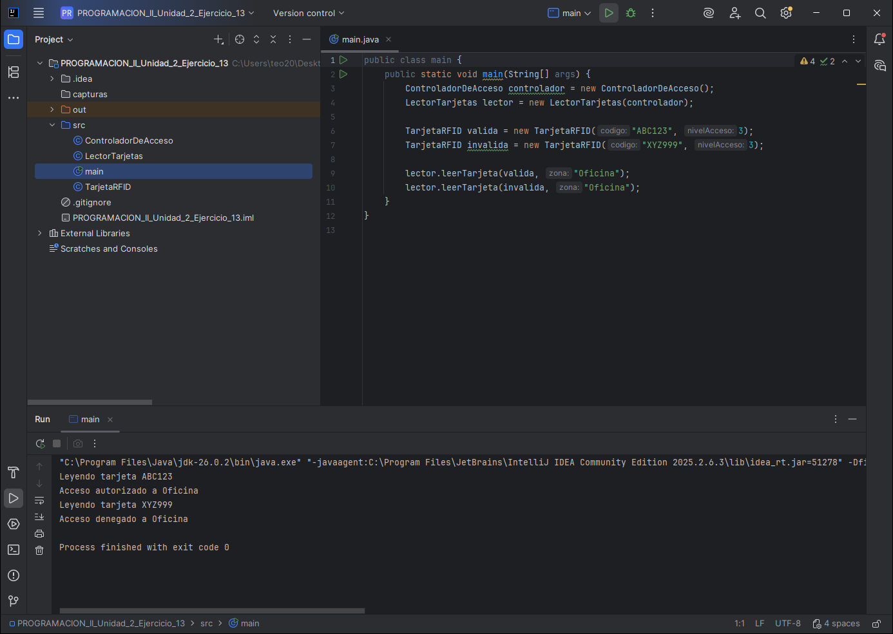

# PROGRAMACIÓN II — Unidad 2, Ejercicio 13: El Sistema de Control de Acceso por Tarjeta

Trabajo práctico de Programación II. Este repositorio contiene la resolución en Java del ejercicio 13 de la Unidad 2.

## Consigna

#### Contexto

En un edificio corporativo, los empleados utilizan una tarjeta de proximidad para ingresar. La lectora de la puerta no decide por cuenta propia si abre o no; en su lugar, envía un mensaje de validación a un objeto ControladorDeAcceso que verifica los permisos del empleado.

#### Consigna

Construir un modelo en Java donde un objeto LectorTarjetas se comunique con un ControladorDeAcceso enviando las credenciales para autorizar el ingreso a una zona restringida.

#### Desarrollo requerido

- Crear la clase Credencial o TarjetaRFID con el código único y el nivel de acceso del empleado.
- Diseñar la clase ControladorDeAcceso con un método verificarAcceso(TarjetaRFID tarjeta, String zona) que retorne un valor booleano.
- Implementar la clase LectorTarjetas que mantenga una asociación con el controlador y reciba la interacción física simulada del usuario.
- En el método main, instanciar el controlador con una base de datos interna de permisos, una tarjeta válida y otra inválida, y probar el flujo de mensajes imprimiendo el resultado del acceso.

## Estructura del repositorio

```
PROGRAMACION_II_Unidad_2_Ejercicio_13/
├── README.md
├── capturas/
│   └── consola.png
└── src/
    ├── ControladorDeAcceso.java
    ├── LectorTarjetas.java
    ├── main.java   # clase con el método main
    └── TarjetaRFID.java
```

## Funcionamiento y lógica

El ejercicio simula un control de acceso con tarjetas RFID: el lector lee la tarjeta y le pregunta al controlador si esa tarjeta puede entrar.

### `TarjetaRFID`

Guarda el `codigo` de la tarjeta y su `nivelAcceso`.

### `ControladorDeAcceso`

Guarda en un `HashMap` los códigos autorizados junto con el nivel mínimo que exige cada uno; la tarjeta `ABC123` está registrada con nivel 2. Su método `verificarAcceso(tarjeta, zona)` busca el código en el mapa:

- Si el código está registrado y la tarjeta tiene un nivel igual o mayor al exigido, autoriza el acceso.
- Si no, lo deniega.

### `LectorTarjetas`

Recibe el controlador en el constructor. Su método `leerTarjeta()` anuncia la lectura y le delega la verificación al controlador.

### `main`

Crea el controlador, el lector y dos tarjetas con nivel 3: `ABC123` (registrada) y `XYZ999` (no registrada). Al leerlas para entrar a la oficina, la primera tiene el acceso **autorizado** y la segunda **denegado**.

## Ejecución

Captura de la consola de IntelliJ IDEA ejecutando el programa:



Salida obtenida:

```
Leyendo tarjeta ABC123
Acceso autorizado a Oficina
Leyendo tarjeta XYZ999
Acceso denegado a Oficina
```
